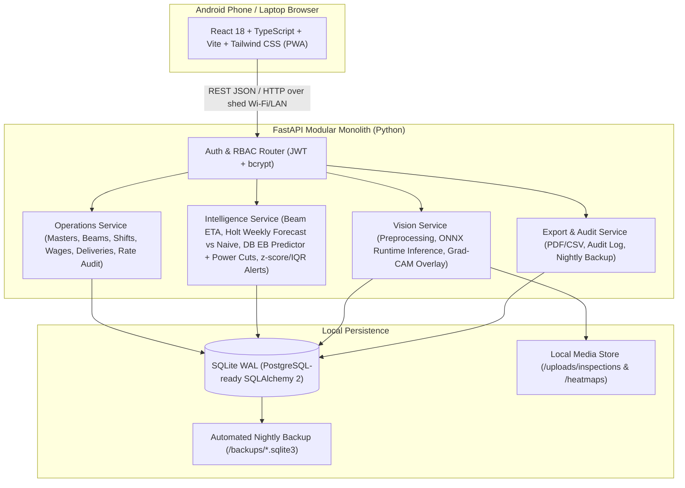

# System Architecture (LOOMOS)

**Last updated:** 2026-11-17

---

## 1. Architectural Choice & Justification

| Candidate | Pros | Cons | Verdict |
|---|---|---|---|
| **Modular Monolith (FastAPI + SQLite/PostgreSQL + React PWA)** | Zero network hops, single process deployment on shed laptop, simple backup (`sqlite3 .backup`), clear module separation, easy for 1 undergraduate to debug and defend in viva | Scales vertically to single shed (20–100 looms) | **Selected** |
| Microservices (separate Auth, Payroll, ML, Reporting services) | Independent deployment | Unnecessary operational complexity, Docker/networking overhead, slow debugging in a 10-week schedule | Rejected |
| Pure Client-Side / Mobile App Only | No backend server needed | Heavy ONNX models + multi-user shared owner/supervisor state require a central backend database and Python ML runtime | Rejected |

---

## 2. High-Level Component Architecture

### Connectivity Choice & Offline Caveat
- **Selected Architecture (v3):** **Same Wi-Fi/LAN with Backend on Laptop** (`http://<laptop-lan-ip>:8000`).
- **Offline Sync Readiness:** Every `shift_entry` stores a unique `client_uuid` generated on submit so an offline sync queue can be layered cleanly later without schema changes. An offline queue is **not** built before Step 2 is finished.
- **HTTPS Caveat:** True offline PWA service workers and `getUserMedia` camera streams require **HTTPS** (which plain LAN `http://` does not provide without a local CA certificate). On plain LAN `http://`, Android Chrome relies on `<input type="file" accept="image/*" capture="environment">` for cloth photos and online form submission over the shed Wi-Fi/hotspot.

---

## 3. Security & Reliability Design

- **Authentication & RBAC:** Short-lived JWT access tokens + `bcrypt`/`argon2` password hashing; strict role enforcement (`OWNER` vs `SUPERVISOR`) on every endpoint via FastAPI dependencies. Supervisors cannot read trader rates, P&L, or edit finalized payslips.
- **Input & File Safety:** Pydantic v2 schemas validate positive quantities, valid shifts (`1|2`), and valid foreign keys. Uploaded cloth photos are restricted to `JPEG/PNG/WEBP` (`<= 10 MB`), sanitized via Pillow re-encoding (stripping EXIF GPS metadata), and saved with UUID filenames.
- **Financial Precision:** All monetary values stored as **integer paise** (`BIGINT`), preventing floating-point penny drift in per-metre calculations and rate-cut checks.
- **Graceful Degradation:** Vision (`ONNX Runtime`) and Forecasting (`statsmodels`/`scikit-learn`) sit behind isolated service wrappers—even if an image upload fails or history is sparse, core shift logging, payroll, and delivery tracking remain 100% operational.
