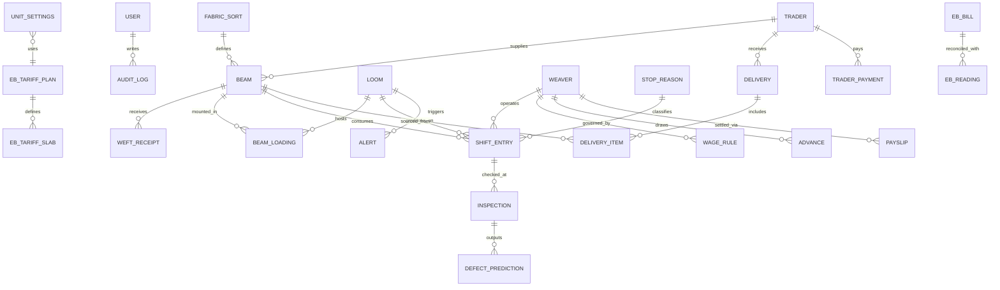

# Relational Database Design (v3 — Normalized 3NF, Soft Deletes & Full Audit Trail)

**Last updated:** 2026-11-17  
**Engine:** SQLite (WAL mode, `PRAGMA foreign_keys = ON`) for local deployment; SQLAlchemy 2 + Alembic migrations structured for zero-rewrite PostgreSQL migration.

---

## 1. Units, History Preservation & Financial Safety Rules
- **Length:** `DECIMAL(12, 2)` in **metres (`m`)**.
- **Weight:** `DECIMAL(10, 3)` in **kilograms (`kg`)**.
- **Currency:** `INTEGER` in **paise** (`₹6.00 = 600`; `₹0.25 = 25`). Zero floating-point drift.
- **Electricity & Time:** `DECIMAL(10, 2)` in **kWh (units)**; downtime in integer **minutes (`mins`)**.
- **Soft Deletes on ALL Financial & Master Records:** No hard SQL `DELETE` on `wage_rules`, `advances`, `payslips`, `deliveries`, `delivery_items`, `trader_payments`, `eb_bills`, `expenses`, `fabric_sorts`, `looms`, `weavers`, or `traders`. Financial tables carry `is_deleted BOOLEAN DEFAULT 0`, `deleted_at`, `deleted_by`, `delete_reason`.
- **Immutable Audit Trail (`audit_logs`):** Every `CREATE`, `UPDATE`, `SOFT_DELETE`, and `FINALIZE` on wages, advances, deliveries, payments, rates, EB bills, and expenses writes an immutable row to `audit_logs`.

---

## 2. Entity Relationship Diagram

---

## 3. Core Table Specifications

| Table | Key Columns & Constraints | Business Rules Enforced |
|---|---|---|
| `unit_settings` | `id`, `unit_name`, `location`, `default_language ('en'\|'ta')`, `shifts_per_day`, `shift_cutoff_hour`, `default_entry_mode ('DIRECT'\|'COUNTER')`, `sanctioned_kw`, `active_tariff_plan_id (FK)`, `setup_completed_at` | Zero hardcoded defaults; bilingual default preference |
| `eb_tariff_plans` & `eb_tariff_slabs` | `plans(id, name, billing_cycle_days, overhead_per_kw_paise, effective_from, is_deleted)`; `slabs(id, plan_id, min_unit, max_unit, rate_paise_per_unit)` | **Zero hardcoded EB slabs**; TANGEDCO LA3A2 seeded as editable DB preset |
| `users` | `id`, `full_name`, `username (UNIQUE)`, `password_hash`, `role ('OWNER'\|'SUPERVISOR')`, `preferred_lang ('en'\|'ta')`, `is_active` | Owner account created first in Step 1 of `/setup` |
| `audit_logs` | `id`, `entity_type`, `entity_id`, `action ('CREATE'\|'UPDATE'\|'SOFT_DELETE'\|'FINALIZE')`, `changed_by (FK users)`, `changed_at`, `old_values_json`, `new_values_json`, `reason` | **Append-only** trace for all edits to wages, advances, deliveries, payments, rates, EB & expenses |
| `looms` | `id`, `loom_number (UNIQUE)`, `loom_type ('SHUTTLE'\|'RAPIER'\|'AIRJET')`, `make_model`, `rated_rpm`, `reed_space_in`, `status`, `is_active` | Dynamic `N`-loom sizing (`L-01`..`L-N`); soft-archived on retire |
| `weavers` | `id`, `full_name`, `full_name_ta`, `role_type ('WEAVER'\|'HELPER'\|'FITTER')`, `phone`, `is_active` | Optional Tamil name for Tamil payslips; covers non-loom helpers |
| `wage_rules` | `id`, `weaver_id (FK)`, `wage_mode ('PER_METRE'\|'PER_LOOM_SHIFT'\|'PER_SHIFT_ATTENDANCE'\|'FIXED_WEEKLY')`, `rate_paise (>0)`, `effective_from`, `effective_to`, `is_deleted`, `deleted_at`, `deleted_by` | Dated history + soft delete + audited changes |
| `traders` | `id`, `company_name`, `contact_name`, `phone`, `is_active` | Job-work client master |
| `fabric_sorts` | `id`, `sort_name`, `warp_count`, `weft_count`, `reed`, `pick`, `width_in`, `agreed_rate_paise`, `expected_weft_kg_per_100m`, `wastage_pct`, `is_active` | Configurable agreed rate + expected weft consumption for wastage flags |
| `beams` | `id`, `beam_no (UNIQUE)`, `trader_id (FK)`, `sort_id (FK)`, `received_date`, `warp_length_m`, `expected_pieces`, `status ('IN_STOCK'\|'RUNNING'\|'COMPLETED')` | Tracks remaining metres & weft kg used vs metres produced |
| `weft_receipts` | `id`, `beam_id (FK)`, `received_date`, `bags`, `net_weight_kg (>0)`, `is_deleted`, `deleted_at`, `deleted_by` | Compared against beam metres produced to flag yarn wastage/shortage |
| `beam_loadings` | `id`, `loom_id (FK)`, `beam_id (FK)`, `loaded_at`, `unloaded_at` | Partial unique index: max 1 active beam per loom |
| `stop_reasons` | `id`, `code (UNIQUE)`, `label_en`, `label_ta`, `is_power_cut BOOLEAN DEFAULT 0`, `is_active` | **`POWER_CUT` flagged explicitly** so downtime feeds EB analysis & lost-output estimates |
| `shift_entries` | `id`, `loom_id (FK)`, `weaver_id (FK)`, `beam_id (FK NULLABLE)`, `entry_date`, `shift_no`, `entry_mode`, `start_meter`, `end_meter`, `net_metres (>=0)`, `downtime_mins`, `stop_reason_id (FK NULLABLE)`, `client_uuid (NULLABLE)`, `UNIQUE(loom_id, entry_date, shift_no, beam_id)` | Allows mid-shift beam changeovers; `client_uuid` prevents duplicate sync if offline queue is chosen |
| `advances` | `id`, `weaver_id (FK)`, `advance_date`, `amount_paise (>0)`, `note`, `is_deleted`, `deleted_at`, `deleted_by`, `delete_reason` | Soft-deleted & audited |
| `payslips` | `id`, `weaver_id (FK)`, `period_start`, `period_end`, `wage_mode_snapshot`, `units_worked`, `rate_paise_snapshot`, `gross_paise`, `advance_deducted_paise`, `defect_deduction_paise`, `net_payable_paise`, `status ('DRAFT'\|'FINALIZED')`, `is_deleted`, `deleted_at`, `deleted_by` | Immutable snapshot once finalized + soft-deleted if voided |
| `deliveries` & `delivery_items` | `deliveries(id, trader_id, challan_no, delivery_date, total_metres, source, is_deleted, deleted_at, deleted_by)`; `delivery_items(id, delivery_id, beam_id, sort_id, pieces, metres, applied_rate_paise, is_deleted)` | Soft-deleted & audited; compares `applied_rate_paise` vs `agreed_rate_paise` |
| `trader_payments` | `id`, `trader_id (FK)`, `payment_date`, `amount_paise`, `reference`, `shortage_deduction_paise`, `is_deleted`, `deleted_at`, `deleted_by` | Soft-deleted & audited; computes running receivable balance |
| `inspections` & `defect_predictions` | `inspections(id, loom_id, beam_id, weaver_id, shift_entry_id, image_path, heatmap_path, review_status ('PENDING'\|'CONFIRMED_DEFECT'\|'CONFIRMED_CLEAN'), reviewed_label, is_reference_sample, inspected_at)`; `defect_predictions(id, inspection_id, model_version, predicted_label, confidence, is_uncertain, inference_ms)` | Saves **every** reviewed shed photo with its human label (`Defect` or `Clean`) to build `LOOMOS-Shed` for true held-out testing & fine-tuning |
| `eb_readings` & `eb_bills` | `eb_readings(id, reading_date, kwh_total, is_deleted)`; `eb_bills(id, tariff_plan_id, period_start, period_end, units_consumed, energy_paise, overhead_paise, net_bill_paise, total_power_cut_mins, is_deleted)` | Stores cycle power-cut duration alongside kWh for normalized EB analysis |
| `expenses` | `id`, `expense_date`, `category`, `amount_paise`, `note`, `is_deleted`, `deleted_at`, `deleted_by` | Soft-deleted & audited |
| `alerts` | `id`, `alert_type`, `loom_id`, `severity`, `message`, `status ('OPEN'\|'ACKNOWLEDGED'\|'DISMISSED')`, `created_at` | Dismissible alerts (`RATE_UNDERPAYMENT`, `YARN_WASTAGE`, `OUTPUT_OUTLIER`, `EB_SLAB_WARNING`) |
